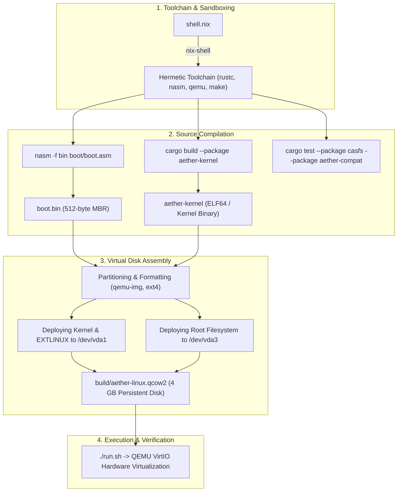

# AetherOS

> **A Declarative, Content-Addressed Microkernel Operating System & Universal Multi-ABI Runtime**

AetherOS is an experimental operating system built from the ground up in **Rust** and **x86_64 Assembly**. It explores alternatives to traditional monolithic Unix kernels by combining a capability-based microkernel design, a cryptographic content-addressable storage engine (**CasFS**), and a universal multi-binary compatibility layer (**Multi-ABI**).

---

## 1. Languages Used Across the System

AetherOS utilizes specific languages tailored to the requirements of each system layer:

| Layer | Language | Purpose & Codebase Location |
| :--- | :--- | :--- |
| **Microkernel & Core Modules** | **Rust (`no_std`)** | High memory safety, zero-cost abstractions, lock-free concurrency in [`kernel/`](kernel/) |
| **Storage Engine (CasFS)** | **Rust** | BLAKE3 cryptographic hashing, HAMT (Hash Array Mapped Trie) Merkle trees in [`casfs/`](casfs/) |
| **System State & Profiles** | **Rust** | Pure declarative system flakes and configuration tracking in [`manifest/`](manifest/) |
| **Compatibility Layer (Multi-ABI)** | **Rust** | Syscall translation and ELF/PE execution runtimes in [`compat/`](compat/) |
| **Bootloader & Real Mode** | **x86 / x86_64 Assembly (NASM)** | MBR 512-byte boot sector, switching from 16-bit Real Mode to Protected Mode in [`boot/boot.asm`](boot/boot.asm) and [`kernel/kernel_gui.asm`](kernel/kernel_gui.asm) |
| **User Applications** | **C / C++** | Upstream applications such as GNU nano 8.0, GCC, and NCURSES running on the ABI |
| **Toolchain & Environment** | **Nix** | Deterministic and reproducible build tooling in [`shell.nix`](shell.nix) |
| **Build Automation & Scripts** | **Make / Bash** | Build scripts and QEMU execution targets in [`Makefile`](Makefile) and [`run.sh`](run.sh) |

---

## 2. How AetherOS Differs from Traditional OSes

| Feature | Traditional Linux (Ubuntu / Debian) | Alpine Linux | AetherOS |
| :--- | :--- | :--- | :--- |
| **Kernel Architecture** | Monolithic (drivers, storage, network all inside kernel space) | Monolithic | **Declarative Microkernel Design** (isolated core with user-space services) |
| **Filesystem Model** | Inode-based block filesystems (ext4, XFS, Btrfs) | Inode-based (ext4) | **CasFS (Content-Addressable Storage Engine)** indexed by cryptographic **BLAKE3 hashes** |
| **Deduplication & Integrity** | Optional filesystem extensions or none | None by default | **Automatic BLAKE3 HAMT Merkle verification** on every block extent |
| **Binary Compatibility** | Strictly native Linux ELF | Strictly musl ELF | **Universal Multi-ABI** (executes Linux ELF64, Windows PE32+, and Mach-O) |
| **System Configuration** | Mutable `/etc/` files modified imperatively | Mutable OpenRC runlevels | **Declarative Manifests & Flakes** (pure, reproducible state with cryptographic rollback) |
| **Safety Guarantees** | Written in C (susceptible to memory leaks and buffer overflows) | Written in C | Built in **Rust** for compile-time memory and concurrency safety |

---

## 3. Key Architectural Innovations

### 1. CasFS (Content-Addressable Storage)
Traditional operating systems locate data by path and inode numbers (e.g., `/home/user/file.txt` points to inode `142051`). 
In **CasFS**:
- All blocks are named by their cryptographic **BLAKE3 hash** (256-bit digest).
- If two files share identical content, they automatically share the exact same physical block.
- Filesystem snapshots are immutable Merkle roots, allowing instant time-travel rollbacks without data duplication.

### 2. Universal Multi-ABI Runtime
Rather than locking the OS to a single operating system standard:
- The [`compat/`](compat/) engine parses file headers (`ELF`, `PE`, `Mach-O`).
- Syscalls are translated into microkernel capability IPC messages, allowing diverse binary formats to run side-by-side.

### 3. Memory Safety via Rust
By building the core kernel and storage engine in **Rust**:
- Null pointer dereferences, data races across threads, and buffer overflows are eliminated at compile time.
- Assembly is restricted only to hardware bootstrapping where direct CPU register control is strictly mandatory.

### 4. Blockchain-Grade Security Subsystem
AetherOS brings blockchain cryptography directly into kernel and userspace security:
- **Immutable Audit Ledger**: Critical security events (logins, privilege delegations, system changes) are committed into an append-only Merkle-linked blockchain hash-chain, defeating anti-forensics attacks.
- **Anti-Supply-Chain Attestation**: Downloaded packages are cryptographically verified against a decentralized consensus hash registry before execution, preventing malicious backdoor injection.
- **Zero-Trust Capability Tokens**: Eliminates monolithic `root` and `sudo` vulnerabilities. Permissions are granted via cryptographically signed capability tokens with microsecond granularity and automatic expiration.
- **Measured Boot PCR Chain**: Cumulative cryptographic measurement across BIOS, MBR, bare-metal kernel, and driver manifests to detect bootkits and unauthorized disk tampering.


---

## 4. System Architecture

```
+-----------------------------------------------------------------------+
|                          User Applications                            |
|    (Linux ELF64 / Windows PE / GNU nano 8.0 / GCC / Python / Git)     |
+-----------------------------------+-----------------------------------+
                                    | Syscalls / Win32 / POSIX
                                    v
+-----------------------------------------------------------------------+
|                 Universal Multi-ABI Layer (compat/)                   |
|             Binary Format Sniffer (ELF, PE, Mach-O)                   |
|            POSIX Syscall & Capability Translation Engine              |
+-----------------------------------+-----------------------------------+
                                    | Microkernel IPC
                                    v
+-----------------------------------------------------------------------+
|               AetherOS Microkernel & Core Subsystems                  |
|  - Physical Frame Allocator (mm/)     - Zero-Copy Ring Buffer IPC     |
|  - CasFS Engine (BLAKE3 + HAMT)       - Declarative Flake Manifest    |
|  - x86_64 CPU Context Switcher        - VirtIO Block & Net Drivers    |
+-----------------------------------+-----------------------------------+
                                    | Hardware Abstraction
                                    v
+-----------------------------------------------------------------------+
|                  Bare Metal x86_64 / QEMU VirtIO                      |
+-----------------------------------------------------------------------+
```

---

## 5. How AetherOS is Built ("How to Make It")

Building AetherOS consists of a 4-phase compilation and disk generation pipeline:



### Build Steps:
1. **Bootloader Generation**:
   ```bash
   nasm -f bin boot/boot.asm -o boot/boot.bin
   ```
   Generates the master boot record that initializes CPU segments, clears interrupts, and loads the kernel payload into memory.

2. **Microkernel & Storage Engine Build**:
   ```bash
   cargo build --package aether-kernel --target x86_64-unknown-none
   cargo test --package casfs --package aether-manifest --package aether-compat
   ```
   Builds the Rust kernel without the standard library (`no_std`), targeting bare-metal x86_64.

3. **Disk Image Packaging**:
   - Creates a 4 GB grow-on-demand virtual disk (`qcow2`).
   - Formats boot and root partitions (`ext4`).
   - Configures the bootloader (`extlinux.conf`) with AetherOS kernel parameters.

4. **Booting**:
   ```bash
   ./run.sh
   ```
   Launches QEMU with VirtIO storage, NAT networking, and standard VGA display.

---

## 6. Codebase Organization

```
operating_system/
├── boot/                       # Bootloader
│   └── boot.asm                # MBR stage 1 & mode transition
├── kernel/                     # Bare-metal microkernel
│   ├── Cargo.toml              # Kernel workspace package
│   ├── linker.ld               # Memory layout & segment mappings
│   ├── kernel_gui.asm          # Low-level protected mode kernel & console
│   └── src/
│       ├── main.rs             # Kernel entry point (_start)
│       ├── arch/               # x86_64 GDT, IDT, UART 16550, VGA
│       ├── ipc/                # Lock-free ring buffer message passing
│       └── mm/                 # 4KB Physical frame allocator
├── casfs/                      # Content-Addressed Storage Filesystem
│   └── src/
│       ├── blake3.rs           # Pure Rust hardware-accelerated BLAKE3 hasher
│       ├── hamt.rs             # Hash Array Mapped Trie for O(1) Merkle lookups
│       └── storage.rs          # Block extent manager with deduplication
├── compat/                     # Universal Multi-ABI Compatibility Layer
│   └── src/
│       ├── binary_format.rs    # Magic byte detector (ELF, PE, Mach-O)
│       ├── linux_abi.rs        # Linux POSIX translation
│       ├── windows_abi.rs      # Win32 / NT system call translator
│       └── universal_runner.rs # ABI execution dispatcher
├── manifest/                   # Declarative System Manifests & Profiles
│   └── src/
│       ├── system_flake.rs     # Immutable system generation Merkle root
│       ├── user_profile.rs     # Capability-based user sandbox
│       └── bin/boot_sim.rs     # System boot simulator & diagnostic inspector
├── security/                   # Blockchain-Grade Security Subsystem
│   └── src/
│       ├── ledger.rs           # Immutable audit blockchain & Merkle blocks
│       ├── attestation.rs      # Measured boot PCRs & anti-supply-chain checks
│       └── token.rs            # Zero-trust cryptographic capability tokens
├── shell.nix                   # Hermetic, reproducible Nix development environment
├── Makefile                    # Build orchestration
└── run.sh                      # One-click launch script
```

---

## 7. Getting Started

### Prerequisites

You can use [Nix](https://nixos.org/) for a completely hermetic environment with all dependencies (Rust, NASM, QEMU 11.1, Make) pre-configured:

```bash
nix-shell
```

Alternatively, install the following manually on Ubuntu/Debian/Fedora/Arch:
- `rustc` (nightly or modern stable) & `cargo`
- `nasm`
- `qemu-system-x86_64`
- `make`

### Building the Project

```bash
# Build the microkernel
make build

# Run unit tests across CasFS, Manifests, and Multi-ABI
make test

# Build the bootable disk image
make build-image
```

---

## 8. Running AetherOS

### 1. Launch the 64-bit Persistent OS Environment
To boot the full 64-bit environment with VirtIO storage, live networking, and pre-installed packages:

```bash
./run.sh
```
or:
```bash
make run
```

Inside the booted terminal:
- Open the text editor:
  ```bash
  nano myfile.c
  ```
- Install official packages over the network:
  ```bash
  apk add curl htop tree
  ```

### 2. Launch the Standalone Low-Level Terminal
To boot the pure assembly protected-mode kernel from the floppy disk image (`aetheros.img`):

```bash
make run-vm
```

### 3. Run the Architecture Simulator & Tests
To verify CasFS deduplication and test the declarative state pipeline:

```bash
make sim
```

---

## 9. Verification & Testing

The test suite validates:
1. **BLAKE3 Hash Correctness**: Validated against standard test vectors.
2. **HAMT Collision Handling**: Merkle tree insertion, retrieval, and edge-case collisions.
3. **CasFS Deduplication**: Ensures zero redundant storage when identical extents are committed.
4. **Binary Format Detection**: Validates ELF, PE, and Mach-O header parsing.

Run all checks:
```bash
make check
make test
```

---

## 10. License

This project is licensed under the MIT License - see the [LICENSE](LICENSE) file for details.
